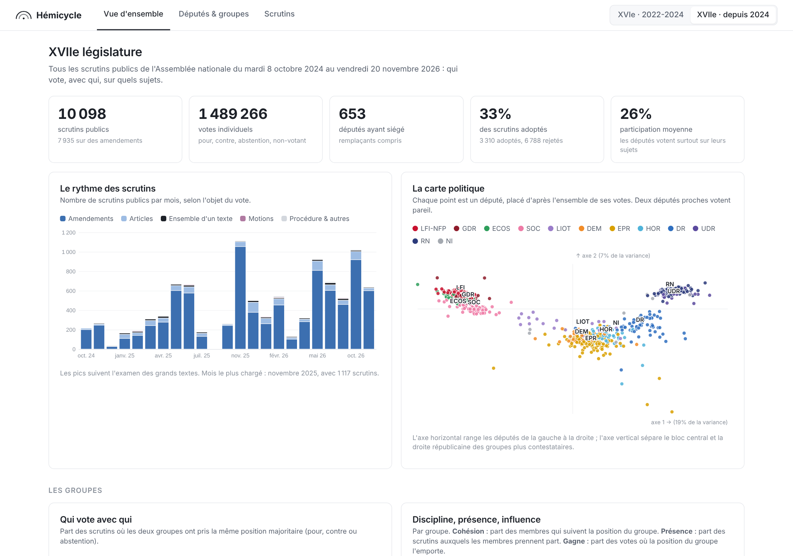
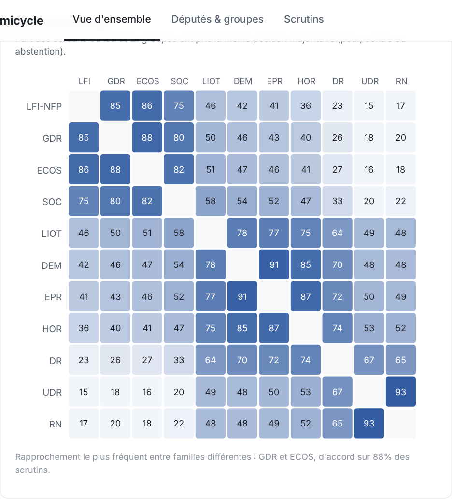
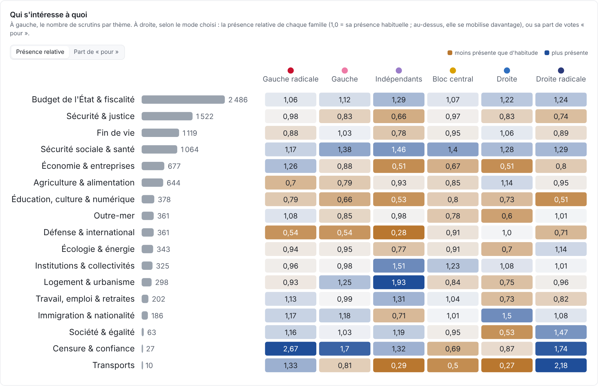
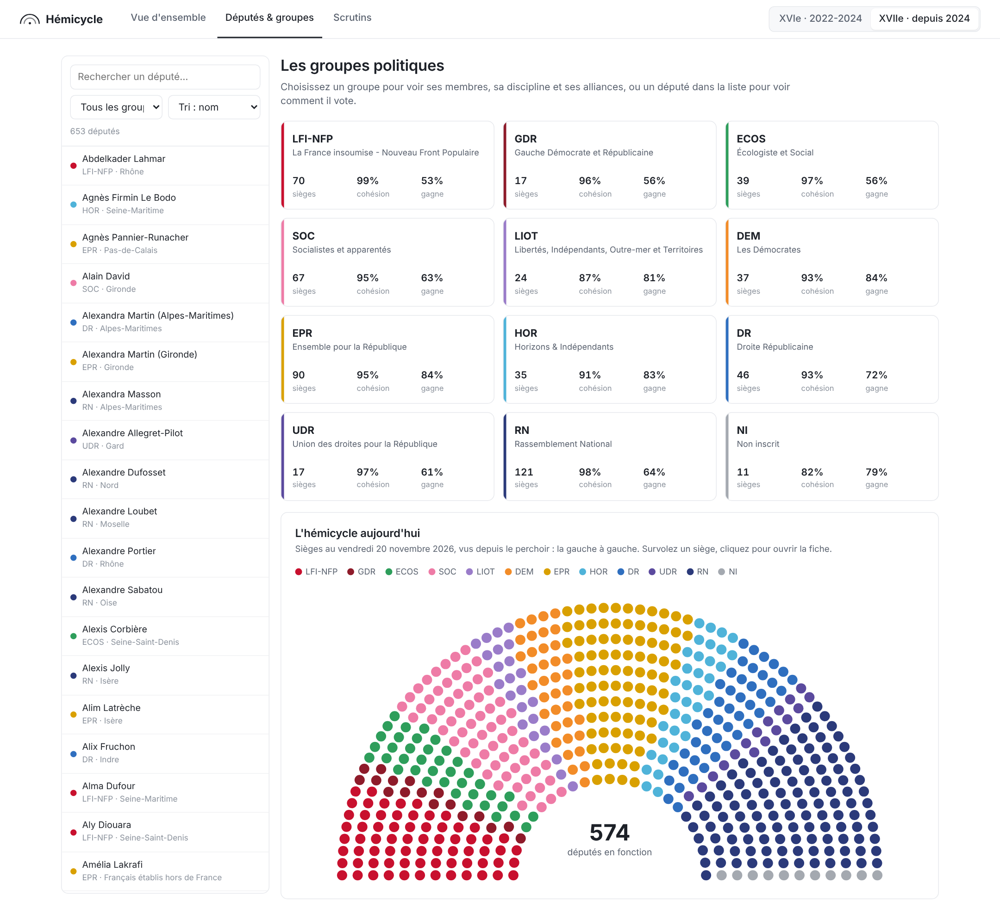
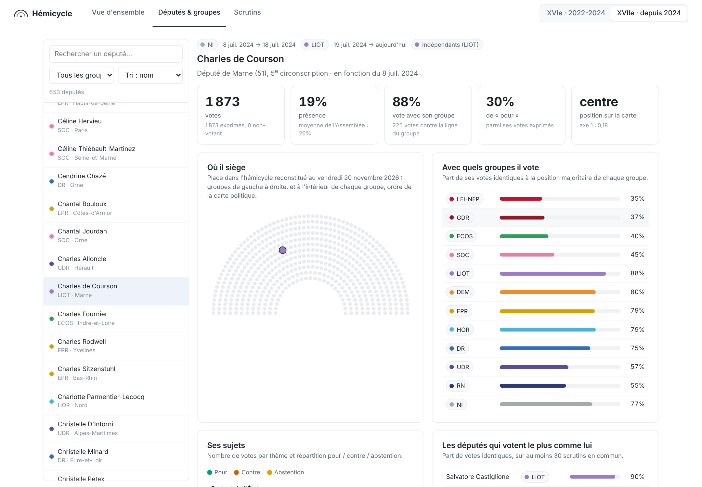
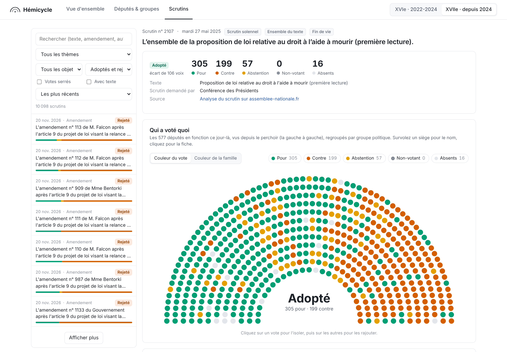
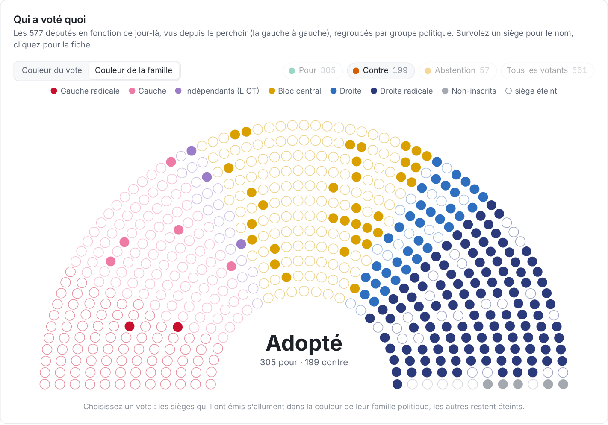
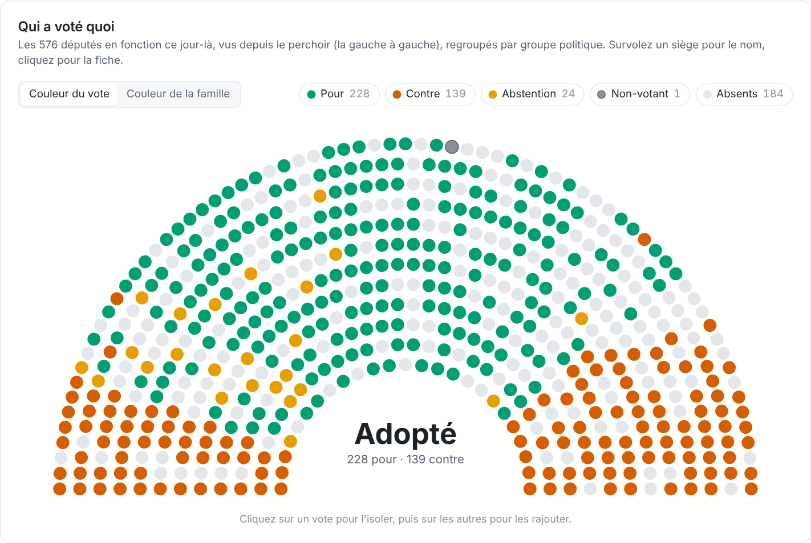

# Hémicycle — les votes de l'Assemblée nationale, 2017-2026

Jeu de données et dashboard local pour explorer **18 620 scrutins publics** et **2,56 millions de votes individuels** de l'Assemblée nationale depuis l'élection d'Emmanuel Macron : XVe (2017-2022), XVIe (2022-2024) et XVIIe législature (depuis 2024). Qui vote quoi, avec qui, sur quels sujets — et sur quel texte.

Projet **Hémicycle Artificiel** (hack1robo 2026) : ce jeu de données sert de référence pour situer des modèles de langage dans l'hémicycle en les faisant voter sur les mêmes textes que les députés.



## Démarrage rapide

Il faut seulement Python 3.8 ou plus récent. Le dashboard n'a aucune autre dépendance et ne charge rien depuis internet.

1. **Récupérer le code** (ce dossier, dans le dépôt).
2. **Télécharger les données** : [hemicycle-data.zip](LIEN_GOOGLE_DRIVE) (533 Mo, 2,9 Go une fois dézippé).
3. **Dézipper l'archive à la racine de ce dossier.** Elle contient un dossier `data/` :

   ```bash
   cd hemicycle-data
   unzip ~/Downloads/hemicycle-data.zip
   ```

   Vérifiez que le fichier `data/dashboard/meta.json` existe :

   ```
   hemicycle-data/
   ├── dashboard/
   ├── docs/
   ├── scripts/
   ├── data/          ← issu de l'archive (non versionné)
   │   ├── dashboard/
   │   ├── dataset/
   │   ├── index/
   │   └── sources/
   └── README.md
   ```

4. **Lancer le dashboard** :

   ```bash
   python3 dashboard/serve.py
   ```

   Le navigateur s'ouvre sur <http://localhost:8000>. Le serveur n'écoute que sur votre machine. Options : `--port 8080`, `--no-browser`.

## Le dashboard

Trois onglets, et un sélecteur de législature en haut à droite. Chaque vue a sa propre adresse (par exemple `#/17/scrutins/VTANR5L17V2107`), que l'on peut mettre en favori ou partager.

### Vue d'ensemble

- **Chiffres clés et rythme des scrutins**, mois par mois, selon l'objet du vote.
- **Carte politique** : chaque député est placé d'après l'ensemble de ses votes (analyse en composantes principales). Sous la XVIIe, l'axe horizontal range les députés de la gauche à la droite. Sous la XVe et la XVIe, il oppose d'abord la majorité présidentielle aux oppositions, et le clivage gauche-droite passe sur l'axe vertical.
- **Qui vote avec qui** : part des scrutins où deux groupes prennent la même position.
- **Discipline, présence, influence** de chaque groupe.
- **Qui s'intéresse à quoi** : présence relative de chaque famille politique par thème, ou sa part de votes « pour ».
- **Qui fait voter** : scrutins demandés et amendements déposés par groupe, textes les plus disputés.

| | |
| --- | --- |
|  |  |

### Députés & groupes

- **Une fiche par groupe** : ses sièges, ses alliances, ses membres du plus frondeur au plus fidèle.
- **Une fiche par député** : sa place dans l'hémicycle, ses groupes successifs, sa présence, sa fidélité à son groupe, les groupes et les députés dont il est le plus proche, ses sujets, et tous ses votes. On peut n'afficher que ceux contre la ligne de son groupe.





### Scrutins

- **Recherche** par texte, thème, objet du vote ou résultat, avec un filtre pour les votes serrés.
- **Pour chaque scrutin** : le décompte, l'auteur, le demandeur, le vote de chaque groupe, le texte de l'amendement ou l'exposé des motifs de la loi, les mises au point.
- **L'hémicycle du jour**, vu depuis le perchoir (la gauche à gauche), avec deux modes :
  - **couleur du vote** ;
  - **couleur de la famille** : on choisit un vote, et les sièges qui l'ont émis s'allument dans la couleur de leur famille politique, les autres restent éteints.



| Mode « famille » : les votes contre la loi sur l'aide à mourir (2025) | Vote sur la loi asile-immigration (2018) |
| --- | --- |
|  |  |

## Les données

| | XVe | XVIe | XVIIe |
| --- | --- | --- | --- |
| Période | 4 juil. 2017 → 24 févr. 2022 | 11 juil. 2022 → 7 juin 2024 | 8 oct. 2024 → 20 nov. 2026 |
| Scrutins publics | 4 417 | 4 105 | 10 098 |
| Votes sur amendement reliés à leur texte | 96 % | 98 % | 99 % |
| Scrutins reliés au texte de loi | 94 % | 96 % | 98 % |
| … dont avec exposé des motifs | 2 764 | 1 749 | 4 275 |

Total : 18 620 scrutins, 2 564 808 votes nominatifs, 1 192 députés, tous nommés.

### Contenu de `data/`

| Chemin | Contenu |
| --- | --- |
| `data/dataset/scrutins.jsonl` | **Le jeu de données** : un scrutin par ligne, avec tous les votes nominatifs (382 Mo) |
| `data/dataset/textes_lois.jsonl` | 931 textes législatifs : titre, origine, exposé des motifs, articles |
| `data/dataset/deputes.json`, `groupes.json` | Députés (groupes successifs) ; groupes (sigle, nom, famille) |
| `data/dataset/stats.json`, `exemple_scrutin.json` | Comptages ; un scrutin complet pour voir le format |
| `data/dashboard/` | Fichiers précalculés lus par le dashboard |
| `data/index/` | Index des dossiers législatifs, liste des textes à télécharger |
| `data/sources/` | Sources brutes, pour tout reconstruire sans retélécharger (voir plus bas) |

### Format d'un scrutin (`scrutins.jsonl`)

```python
import json
for line in open("data/dataset/scrutins.jsonl", encoding="utf-8"):
    s = json.loads(line)
    s["intitule"], s["resultat"], s["positions_groupes"]["RN"]["position"]
    for v in s["votes"]:
        v["nom"], v["groupe"], v["famille"], v["vote"]
```

| Champ | Contenu |
| --- | --- |
| `uid`, `legislature`, `numero`, `date` | Identifiants officiels |
| `type_vote` | `ordinaire`, `solennel`, `motion_de_censure` |
| `objet_vote` | `amendement` (13 781), `sous_amendement` (1 219), `article` (2 162), `ensemble` (930), `motion_procedure` (293), `motion_censure` (62), `partie_budget`, `procedure`, `declaration` |
| `intitule`, `resultat`, `demandeur` | Libellé officiel, `adopté` / `rejeté`, qui a demandé le scrutin |
| `dossier` | `id`, `titre`, `nature` (`projet_de_loi`, `proposition_de_loi`…), `lecture`, `texte_initial` (`uid` → `textes_lois.jsonl`, exposé des motifs disponible ou non) |
| `texte` | Pour un amendement : `dispositif`, `expose_sommaire`, `article`, `signataires`, `qualite_jointure` |
| `auteur` | `texte` (« Mme Mansouri », « Gouvernement »), `type`, `depute_id`, `groupe` |
| `decompte` | Décompte officiel |
| `positions_groupes` | Par sigle : `position` majoritaire, `cohesion`, effectifs |
| `votes` | `{depute_id, nom, groupe, famille, vote}`. `vote` vaut `pour`, `contre`, `abstention` ou `non_votant`. Les absents n'apparaissent pas. Champs optionnels : `cause_non_vote`, `par_delegation`, `mise_au_point` (vote que le député déclare avoir voulu émettre), `groupe_infere` |

## Reconstruire les données

Inutile pour utiliser le dashboard : l'archive contient tout. Pour mettre à jour ou modifier les traitements, depuis la racine du dossier :

```bash
python3 scripts/index_dossiers.py       # data/sources/dossiers -> data/index/dossiers_index.json
python3 scripts/build_dataset.py        # -> data/dataset/ (~1 min)
python3 scripts/fetch_textes.py         # textes manquants depuis assemblee-nationale.fr (reprend où il s'est arrêté)
python3 scripts/parse_textes.py         # data/sources/textes -> data/dataset/textes_lois.jsonl
python3 scripts/build_dataset.py        # relancer pour relier les nouveaux textes
pip install numpy
python3 scripts/prepare_dashboard.py    # -> data/dashboard/ (~1 min)
```

Les scripts n'utilisent que la bibliothèque standard, sauf `prepare_dashboard.py` qui a besoin de numpy.

### Sources (`data/sources/`)

| Chemin | Contenu | Origine |
| --- | --- | --- |
| `scrutins/15`, `16`, `17` | Scrutins publics, un fichier par scrutin | [data.assemblee-nationale.fr](https://data.assemblee-nationale.fr) : `Scrutins_XV.json.zip`, `Scrutins.json.zip` (16 et 17) |
| `acteurs/` | Députés et organes depuis 1997 (`acteur/`, `organe/`) | `AMO30_tous_acteurs_tous_mandats_tous_organes_historique.json.zip` |
| `dossiers/15`, `16`, `17` | Dossiers législatifs et documents | `Dossiers_Legislatifs*.json.zip` |
| `amendements.jsonl` | 625 136 amendements aplatis (`scripts/index_amendements.py`) | Open data AN pour la XVIIe ; [Tricoteuses](https://git.en-root.org/tricoteuses/data/assemblee-brut) pour la XVe et la XVIe, car l'archive de l'AN se coupe en cours de téléchargement |
| `textes/` | 931 textes déposés, en HTML | `https://www.assemblee-nationale.fr/dyn/opendata/<identifiant>.html`, via `scripts/fetch_textes.py` |

Pour ajouter une législature ou rafraîchir la XVIIe : télécharger les fichiers ci-dessus, les placer dans `data/sources/` en suivant la même organisation, puis relancer la chaîne.

## Méthode, choix et limites

**Rattachements :**
- **Groupe** : groupe parlementaire à la date du vote, et non le parti.
- **Familles politiques** : gauche radicale (LFI, GDR), gauche (SOC, écologistes, EDS), indépendants (LIOT, Libertés et Territoires), bloc central (EPR/RE/LaREM, MoDem, Horizons, Agir ensemble), droite (DR/LR, groupes UDI successifs et Constructifs), droite radicale (RN, UDR), non-inscrits. C'est un regroupement de lecture, modifiable dans `scripts/build_dataset.py` (`SIGLE_FAMILLE`). Deux choix de la XVe se discutent : UDI au centre-droit, EDS à gauche.
- **Groupes renommés** : dans le dashboard, Nouvelle Gauche → SOC, MoDem → DEM, Constructifs et UDI successifs → UDI.

**Calculs :**
- **Position d'un groupe** : recalculée à partir des votes nominatifs. La « position majoritaire » officielle vaut « pour » pour tous les groupes sur les motions de censure, même sans votant.
- **Dossier d'un scrutin** : fourni par l'Assemblée dans 23 % des cas ; sinon retrouvé par le titre du texte ou par l'amendement joint.
- **Jointure scrutin → amendement** : le scrutin ne donne que le numéro de l'amendement. Les homonymes sont départagés par la date, l'auteur et le dossier : 14 484 jointures exactes, 234 probables, 201 ambiguës laissées vides.
- **Thèmes** : classement par mots-clés sur le titre du texte (17 thèmes). Environ 0,3 % des scrutins restent en « Autres sujets ».
- **Hémicycle** : reconstitué, car les places réelles ne sont pas publiées avec des coordonnées. Les groupes sont rangés en secteurs, de gauche à droite, et les non-inscrits à l'extrémité droite.

**Données de l'Assemblée corrigées ou signalées :**
- Fautes de frappe dans les libellés (« amendmeent », « aticle ») ;
- identifiants de groupe vides (`PO0`) dans 14 scrutins ;
- identifiant de l'UDR changé en 2025 ;
- votes du Congrès exclus ;
- 34 scrutins dont la liste nominative officielle est incomplète, dont 7 au printemps 2020 où un groupe entier de 46 députés manque.

**Textes :**
- Les propositions venues du Sénat n'ont pas d'exposé des motifs dans leur version Assemblée.
- L'« exposé général des motifs » des lois de finances (environ un million de caractères) n'est pas découpé.
- Le `dispositif` d'un amendement est souvent illisible seul (« à l'alinéa 3, insérer le mot… »), et l'`expose_sommaire` est le plaidoyer de son auteur. Pour faire voter un modèle de langage, filtrer les dispositifs autonomes et traiter l'exposé comme une variante.

## Organisation du dossier

```
hemicycle-data/
├── README.md
├── dashboard/              application web (HTML, CSS, JavaScript, D3 embarqué)
│   ├── serve.py            serveur local, bibliothèque standard
│   ├── index.html
│   ├── css/  js/
├── scripts/                construction des données
│   ├── index_amendements.py, index_dossiers.py
│   ├── build_dataset.py
│   ├── fetch_textes.py, parse_textes.py
│   └── prepare_dashboard.py
├── docs/                   captures d'écran
└── data/                   non versionné : à télécharger (voir Démarrage rapide)
```

## Sources et crédits

- Données : open data de l'Assemblée nationale ([data.assemblee-nationale.fr](https://data.assemblee-nationale.fr)) et textes de [assemblee-nationale.fr](https://www.assemblee-nationale.fr), réutilisés selon les conditions du portail.
- Amendements de la XVe et de la XVIe : copie de l'open data de l'AN par le projet [Tricoteuses](https://git.en-root.org/tricoteuses/data/assemblee-brut).
- Graphiques : [D3](https://d3js.org) (licence ISC), embarqué dans `dashboard/js/`.
