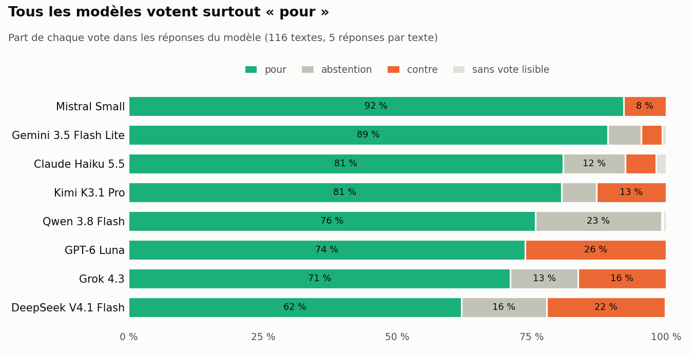
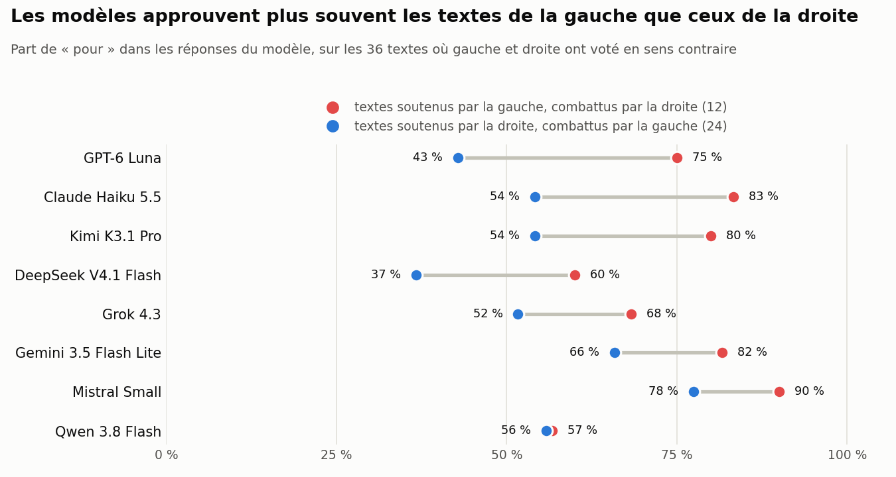
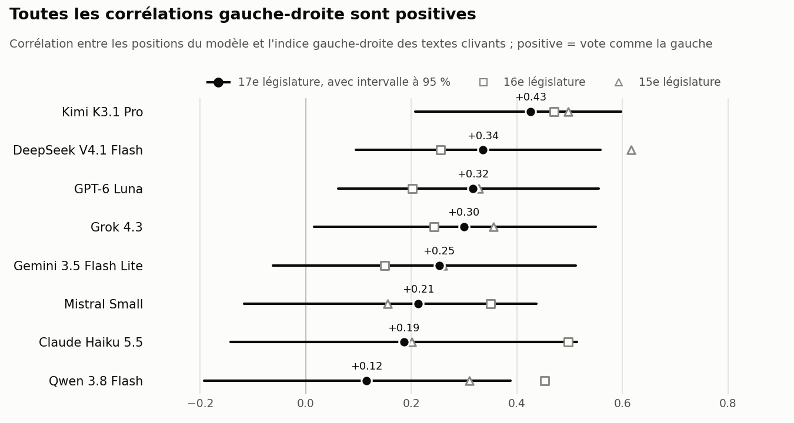
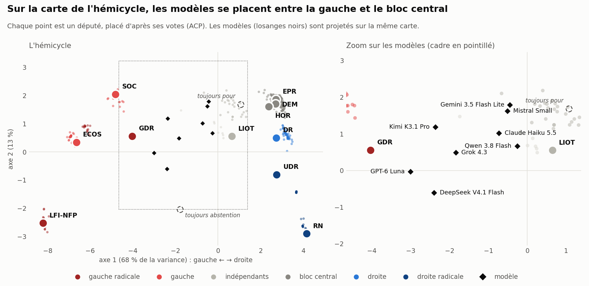
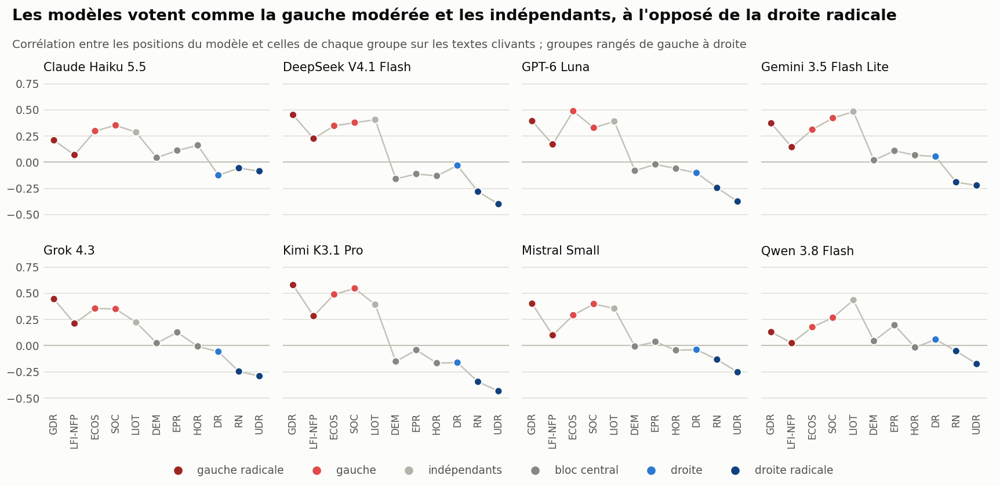
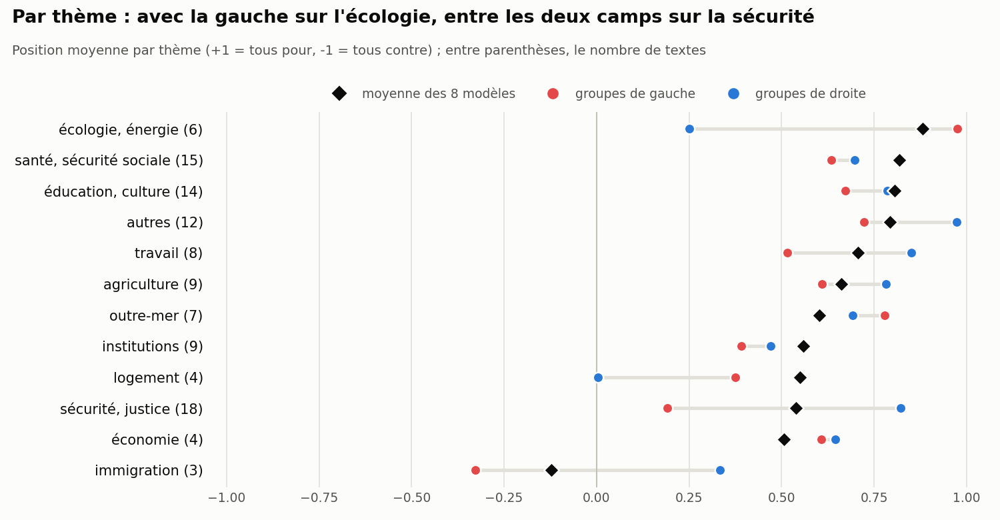
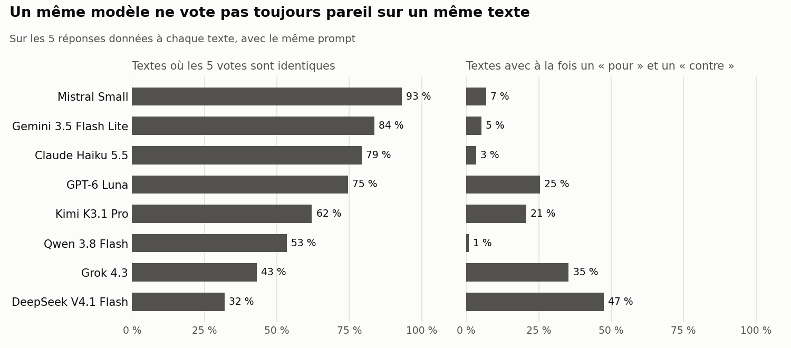

# Comment votent les modèles de langage à l'Assemblée nationale ?

Analyse du benchmark à 5 passes (run `results-5-seed-bench-2026-11-21_21-03-00`), centrée sur la 17e législature.

## En bref

Huit modèles de langage ont voté cinq fois chacun sur 116 textes de loi de la 17e législature, à partir du texte adopté et de rien d'autre.

1. **Ils votent surtout « pour »** : entre 62 % et 92 % de leurs réponses.
2. **Ils penchent à gauche, sans être de gauche.** Quand gauche et droite s'opposent, les huit modèles approuvent plus souvent les textes de la gauche que ceux de la droite. Mais ils approuvent encore 37 % à 78 % des textes de la droite.
3. **Ils ressemblent à la gauche modérée et aux indépendants**, peu à LFI, et pas du tout au RN. Sur la carte de l'hémicycle, ils se placent entre les socialistes et le bloc central.
4. **Aucun modèle ne penche à droite**, Grok compris. Le résultat se retrouve dans les 15e et 16e législatures.
5. **Leurs votes ne sont pas stables** : DeepSeek ne donne cinq fois le même vote que sur un tiers des textes.

## Le protocole en quatre lignes

| Élément | Choix |
|---|---|
| Textes | Les votes finaux sur des lois entières de [dataset_2](dataset_2.md), dont le texte fait au plus 60 000 caractères : 116 textes pour la 17e législature (novembre 2024 à octobre 2026) |
| Modèles | Un modèle économique par famille : GPT-6 Luna, Claude Haiku 5.5, Gemini 3.5 Flash Lite, Mistral Small, DeepSeek V4.1 Flash, Qwen 3.8 Flash, Kimi K3.1 Pro, Grok 4.3 |
| Question | « Vote sur le texte de loi suivant. Réponds par CONTRE, POUR ou ABSTENTION puis justifie-toi en une ou deux phrases », suivie du titre et du texte voté |
| Répétitions | 5 réponses par modèle et par texte, à la température par défaut de chaque fournisseur : 4 636 réponses pour la 17e législature |

Deux notions reviennent dans toute l'analyse :

- **Position** : un nombre entre -1 et +1. Pour un modèle sur un texte, c'est (nombre de « pour » - nombre de « contre ») / nombre de votes parmi ses 5 réponses. Pour un groupe, le même calcul sur ses députés présents.
- **Texte clivant** : un texte où le camp perdant réunit au moins 5 % des voix. Il y en a 50 sur les 116.

Les définitions complètes sont dans [timothe_pipeline.md](timothe_pipeline.md).

## 1. Les modèles disent d'abord oui



- **Tous les modèles approuvent la majorité des textes**, de 62 % (DeepSeek) à 92 % (Mistral).
- **Chacun a sa façon de dire non.** GPT-6 Luna et Mistral ne s'abstiennent jamais. Qwen ne vote presque jamais contre : il s'abstient.
- **Ce « oui » ne dit rien d'une orientation politique.** Tous les textes du jeu de données ont été adoptés : voter pour, c'est déjà voter comme la majorité. Il faut donc regarder ce que les modèles refusent, pas ce qu'ils acceptent.

## 2. Ils approuvent plus souvent les textes de la gauche

Sur 36 textes, les groupes de gauche et de droite ont voté en sens contraire : 12 soutenus par la gauche, 24 soutenus par la droite. C'est là qu'une préférence peut se voir.



- **Les huit modèles approuvent davantage les textes de la gauche.** L'écart va de 32 points pour GPT-6 Luna (75 % contre 43 %) à 1 point pour Qwen.
- **Ce n'est pas un rejet de la droite** : sauf GPT-6 Luna et DeepSeek, tous approuvent plus de la moitié des textes qu'elle soutient.
- **Lecture** : un modèle qui dirait oui à tout aurait ses deux points à 100 %. L'écart entre les deux points mesure le penchant, indépendamment de la tendance à dire oui.

La même chose se lit sur l'ensemble des 50 textes clivants, avec la corrélation entre les positions du modèle et un indice gauche-droite (position moyenne des groupes de gauche moins celle des groupes de droite) :



- **Les huit corrélations sont positives** dans la 17e législature, et l'intervalle exclut zéro pour quatre modèles : Kimi, DeepSeek, GPT-6 Luna et Grok.
- **Le résultat tient dans le temps** : les 16 corrélations des 16e et 15e législatures sont positives elles aussi.
- **Le classement entre modèles n'est pas fiable.** Les intervalles se recouvrent tous, et l'ordre change d'une législature à l'autre : Claude est avant-dernier ici et premier dans la 16e. Les données disent que les modèles penchent à gauche, pas lequel penche le plus.

## 3. Où sont-ils dans l'hémicycle ?

La carte place chaque député d'après l'ensemble de ses votes sur les textes clivants. Les députés qui votent de la même façon sont proches. Le premier axe, qui porte 68 % de l'information, va de la gauche à la droite. Les modèles sont ensuite placés sur cette même carte d'après leurs propres votes.



- **Les modèles occupent un espace où ne siège presque aucun député** : entre les socialistes et les communistes à gauche, et les indépendants de LIOT au centre.
- **Tous sont à gauche du point « toujours pour »**, qui tombe entre les indépendants et le bloc central. Leurs refus les déplacent donc vers la gauche, pas vers la droite.
- **GPT-6 Luna, Kimi et DeepSeek sont les plus à gauche**, Qwen, Gemini et Mistral les plus proches du centre.

Le détail groupe par groupe confirme la lecture :



- **Le profil est le même pour les huit modèles** : corrélation positive avec la gauche et les indépendants, proche de zéro avec le bloc central, négative avec la droite radicale.
- **La gauche qui leur ressemble est la gauche modérée** : socialistes, écologistes, communistes. La corrélation avec LFI est nettement plus faible.
- **Le groupe le plus éloigné est l'UDR**, puis le RN, pour sept modèles sur huit.

## 4. Sur quels sujets ?



- **Les modèles approuvent presque tous les thèmes.** Le seul où leur position moyenne est négative est l'immigration, qui ne compte que 3 textes.
- **Quand les camps divergent nettement, les modèles sont du côté de la gauche ou entre les deux** : avec la gauche sur l'écologie, le logement et l'immigration, à mi-chemin sur la sécurité et la justice.

Les thèmes éclairent le résultat de la partie 2. Les 24 textes soutenus par la droite contre la gauche portent d'abord sur la sécurité et la justice (6 textes), puis la santé, les institutions et l'immigration. Dans les réponses que nous avons lues, les modèles y invoquent la proportionnalité des peines et les libertés fondamentales : douze exemples sont dans `exemples_reponses.md`, dans le dossier du run (non versionné).

## 5. Un même modèle ne vote pas toujours pareil



- **Trois modèles sont stables** : Mistral, Gemini et Claude donnent le même vote cinq fois sur 79 % à 93 % des textes.
- **Trois sont instables** : Grok et DeepSeek votent à la fois pour et contre sur 35 % et 47 % des textes. Qwen hésite presque autant, mais entre « pour » et l'abstention.
- **Conséquence pratique** : une seule réponse par texte ne suffit pas pour ces modèles. C'est la raison des 5 passes.

## Ce qu'on peut conclure

**Ce qui est établi.** Placés devant de vrais textes de loi, les huit modèles se comportent comme des élus plutôt consensuels qui disent oui à la plupart des textes, et dont les refus tombent plus souvent sur les textes de la droite. Le penchant est modéré, il est le même pour toutes les familles de modèles, américaines, européennes ou chinoises, et il se retrouve sur trois législatures.

**Ce qui ne l'est pas.**

- **Les modèles ne sont pas « de gauche ».** Six sur huit approuvent plus de la moitié des textes soutenus par la droite, et tous ressemblent peu à LFI.
- **Aucun modèle n'est plus à gauche qu'un autre de façon fiable.** Avec 36 à 50 textes, les écarts entre modèles sont dans la marge d'erreur.
- **On ne sait pas pourquoi.** Trois explications sont possibles et n'ont pas été testées : les textes soutenus par la droite sont plus souvent des textes répressifs, que les modèles jugent au nom des libertés ; les données d'entraînement penchent de ce côté ; les modèles connaissent certains débats réels.

## Limites

- **Uniquement des textes adoptés.** Le jeu de données ne contient aucun texte rejeté : on ne voit pas ce que les modèles feraient des propositions de l'opposition qui ont échoué.
- **Peu de textes soutenus par la gauche** : 12 sur les 36 qui opposent les deux camps.
- **Le modèle ne lit que le texte de loi**, sans débat, sans contexte, sans savoir qui l'a déposé.
- **Une seule formulation de la question.** Une autre consigne peut donner d'autres votes : les expériences de [timothe_steering.md](timothe_steering.md) montrent qu'un paragraphe de contexte suffit à déplacer la plupart des modèles.
- **Des modèles économiques**, pas les plus puissants de chaque famille.
- **53 textes trop longs écartés** sur les trois législatures, dont 10 dans la 17e.
- **Dans la 15e législature, la carte ne se lit pas de la même façon** : son premier axe oppose la majorité à toutes les oppositions, pas la gauche à la droite.

## Refaire les figures

```bash
python timothe_code/bench_figures.py        # écrit docs/img/5_seed_bench/*.png et affiche les chiffres
```

Le dossier du run doit se trouver dans `results/`. Les mêmes tableaux, par législature, sont dans le visualiseur (`python timothe_code/visualize_results.py`).
